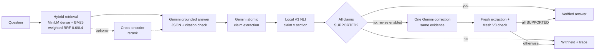

# RAGForge

RAGForge is a retrieval-augmented question-answering system over company policy documents, built step by step as a learning and portfolio project. It goes beyond "retrieve and generate": every factual claim in an answer can be checked by a **locally fine-tuned NLI model**, and an answer that cannot be verified is **withheld rather than shown**. An optional single correction pass asks Gemini to repair a failed answer, which is then verified again from scratch.

**Status: v1.0, complete.** The project is closed as a learning project. It is not a production system, and its evaluations are small and partly provisional (see [Results](#results)).

## Why

A standard RAG system can cite the right section and still state something the section does not say. Citation checks only prove that a cited section was supplied. RAGForge explores how far a small, cheap, local verifier can close that gap, where it fails, and what it costs:

- retrieval quality: dense vs lexical vs fused retrieval, with section-level metrics;
- grounding: structured, citation-validated generation;
- verification: atomic claims checked against evidence by a fine-tuned NLI cross-encoder;
- safety: fail-closed behaviour whenever verification cannot be trusted;
- correction: one evidence-guided revision, re-verified, with honest measurement of when it helps.

## Architecture



Full diagram, component table and decision rules: [docs/ARCHITECTURE.md](docs/ARCHITECTURE.md).

### Three ways to run it

| | 1. Standard RAG | 2. RAG + local verification | 3. RAG + verification + correction |
|---|---|---|---|
| Flags | *(none)* | `--verify` | `--verify --revise` |
| What you get | answer + citations | the answer only if V3 marks every claim SUPPORTED | as in 2, plus one repair attempt for a failed answer |
| Checks | JSON schema; citations name supplied sections | + claim extraction and per-claim NLI against every evidence section | + fresh extraction and fresh verification of the corrected answer |
| On failure | invalid output or bad citations → no answer | unverified, or verifier unavailable → withheld | correction fails or stays unverified → withheld |
| Gemini calls | 1 | 2 | 2–4 |
| Added latency | – | ~0.1 s (local) | ~13 s median when a correction runs (4 measured cases) |

## Components

- **Dense retrieval:** `sentence-transformers/all-MiniLM-L6-v2` embeddings with cosine similarity. Chunks are section-aware: at most 120 words, and never crossing a section.
- **BM25:** a small self-contained implementation. It's strong on exact identifiers such as `FIN-205.3`.
- **Weighted reciprocal rank fusion:** combines both rankings. Dense 0.6 / BM25 0.4 is the RAG default.
- **Cross-encoder reranking (optional):** `cross-encoder/ms-marco-MiniLM-L-6-v2` reranks the top 20 candidates (`--method hybrid-rerank`).
- **Gemini grounded generation:**
  - evidence goes in delimited blocks;
  - output is structured JSON (`answer`, `citations`, `abstained`), strictly schema-validated, with exact citation-ID checks;
  - Gemini abstains when the evidence is insufficient.
- **Atomic claim extraction:** Gemini splits the answer into self-contained claims. Its output is validated for IDs, duplicates and numbers that drift from the answer.
- **Fine-tuned V3 NLI verification:**
  - `cross-encoder/nli-MiniLM2-L6-H768`, fully fine-tuned on a policy NLI dataset built for this project;
  - each claim is scored against each evidence section;
  - the results are combined by conservative, deterministic rules: a contradiction outweighs support, and there are no probability thresholds.
- **One-pass targeted correction:** Gemini receives every claim's verdict, reason and supporting / contradicting sections, including both sides of any conflict, and revises once. The result is extracted and verified again on the same evidence.
- **Fail-closed withholding:** any extraction, verification, citation or API failure, or any unsupported claim, ends with the answer withheld and a full trace.

## Results

Measured in this repository; details and caveats are in [docs/EVALUATION.md](docs/EVALUATION.md).

| Stage | Result | Scope |
|---|---|---|
| Retrieval (hybrid RRF 0.6/0.4) | Section Hit@1 0.838, Recall@5 0.977, MRR@5 0.897 | 37 development questions |
| V3 NLI, validation | macro-F1 **0.849** (zero-shot: 0.618) | 190 examples, 3 families |
| V3 NLI, held-out test (run once) | accuracy **0.934**, macro-F1 **0.925**, false-SUPPORTED 1/105 | 196 examples, unseen families, same synthetic corpus |
| V3 in the pipeline (M6.4A) | accuracy **0.800**, macro-F1 **0.803**, false-SUPPORTED **4/25**; unseen documents **6/9** | 40 hand-written benchmark claims |
| Correction (M6.4C, partial) | V3 accepted 0/4 without correction and 2/4 with it | only **4 of 12** planned cases (Gemini quota) |

In the M6.4C correction cases:
- both answers that V3 accepted were provisionally judged correct;
- no incorrect answer was shown;
- 2 correct revisions were withheld.

What the results mean:

- **The data is synthetic.** All documents and NLI data are synthetic and in-house, so the high held-out NLI score does not carry over to hand-written claims or unseen documents.
- **V3's two main weaknesses:**
  - *Entity/number confusion:* it accepts a number that belongs to a different rule.
  - *False contradictions:* it treats a related rule about a different quantity as contradicting the claim, which withholds correct answers.
- **A live refund example shows the second one.** Correction was attempted, but the answer stayed withheld because V3 rejected claims the evidence supports. The same failure was reproduced in M6.4C: V3 read the refund-*processing* time as contradicting the refund *window*.
- **The M6.4C correction results are provisional:**
  - the labels haven't been reviewed by a human;
  - the errors were seeded deliberately;
  - eight cases were never run.

  They do not establish production reliability, and they don't show that correction improves accuracy in general.

## Setup

Tested with Python 3.13 on macOS (Apple M4 Pro, MPS); Python 3.11–3.13 should work. The CPU is used automatically when no GPU is available.

```bash
git clone https://github.com/ggrewal3/ragforge.git
cd ragforge
python3 -m venv .venv
source .venv/bin/activate
pip install -r requirements.txt
cp .env.example .env        # then put your Gemini API key in .env
```

On first use, `all-MiniLM-L6-v2` and (for reranking) `ms-marco-MiniLM-L-6-v2` download to the Hugging Face cache (~90 MB each). Model weights are never stored in the repository.

### Environment variables

| Variable | Required | Purpose |
|---|---|---|
| `GEMINI_API_KEY` | for generation, extraction and correction | Gemini API key; read from `.env` or the environment, never printed or logged |
| `GEMINI_MODEL` | no | model ID; `.env.example` uses `gemini-3.5-flash`, the code default is `gemini-3.8-flash` |
| `RAGFORGE_MODEL_TESTS=1` | no | also run tests that load real local models |
| `RAGFORGE_LIVE_API_TESTS=1` | no | also run one live Gemini test |

`.env` is Git-ignored. Retrieval, reranking and NLI verification need no API key.

### The V3 checkpoint (important)

The fine-tuned verifier lives in `artifacts/nli/m6.3/v3-full-seed42-20261028-055715/` (about 330 MB of weights plus run metadata). **`artifacts/` is Git-ignored, so a fresh clone does not include it.**

**Without it:**
- standard RAG, retrieval and every other component work normally;
- `--verify` with the default local verifier **fails closed**: it reports that the checkpoint is missing and makes no Gemini call;
- `--verify --verifier gemini` still works, using the experimental LLM verifier.

**To restore it:** copy the whole run directory back to the same path. Keep `test_metrics.json`, because the loader checks the weights against the hashes recorded there.

**To retrain instead:** run `python -m src.nli_train --train full` and point to the new run with `--nli-run`. Be aware:
- a retrained model is a different model;
- its integrity can't be checked against the original test metadata;
- the published held-out results don't apply to it.

**The project is only fully reproducible with the original checkpoint, which must be backed up separately.**

## Usage

```bash
# Retrieval only (no API key)
python -m src.retrieve --question "What does FIN-205.3 say?" --method hybrid

# 1. Standard RAG
python -m src.rag --question "How long do domestic customers have to request a refund?"

# 2. RAG + local V3 verification (unverified answers are withheld)
python -m src.rag --question "How long do domestic customers have to request a refund?" --verify

# 3. RAG + verification + one targeted correction
python -m src.rag --question "How long do domestic customers have to request a refund?" --verify --revise

# Full trace as JSON (claims, per-section NLI labels, uncalibrated scores, correction feedback, timings)
python -m src.rag --question "..." --verify --revise --json

# Options
python -m src.rag --question "..." --method hybrid-rerank --evidence-k 5
python -m src.rag --question "..." --verify --nli-device cpu
python -m src.rag --question "..." --verify --nli-run artifacts/nli/m6.3/<run>
python -m src.rag --question "..." --verify --verifier gemini            # experimental M5 verifier
```

## Testing

```bash
python -m unittest discover -s tests                          # offline: no network, API key or checkpoint needed
RAGFORGE_MODEL_TESTS=1 python -m unittest discover -s tests   # also loads local models and the V3 checkpoint if present
```

The offline suite uses fakes for Gemini and the NLI model. At v1.0, **453 tests passed and 12 were skipped**. The skipped tests need real models, the V3 checkpoint or a live API key.

## Evaluation scripts

| Command | What it does | Gemini? |
|---|---|---|
| `python -m src.evaluate --split development --compare` | retrieval benchmark (dense, BM25, RRF weightings) | no |
| `python -m src.evaluate --split development --rerank` | reranking comparison | no |
| `python -m src.evaluate_generation --dry-run [--verify]` | generation / verification harness with a mocked Gemini | no |
| `python -m src.evaluate_verification --dry-run` | 40-claim verification benchmark with the mock verifier | no |
| `python -m src.nli_dataset ...`, `python -m src.nli_review ...` | build, audit, review and freeze the NLI dataset | no |
| `python -m src.nli_train --baseline` / `--train frozen` / `--train full` / `--compare` | M6.3 experiments (train / validation only) | no |
| `python scripts/m64a_offline_eval.py` | M6.4A offline V3 evaluation (benchmark, aggregation, title sensitivity on validation) | no |
| `python scripts/m64c_eval.py --plan` / `--dry-run` | M6.4C controlled correction evaluation: budget, or an offline dry run | no |
| `python scripts/m64c_eval.py --live --run-id RUN --confirm-live [--min-interval-s 15]` | M6.4C live run; resumable, stops on API errors | yes |

Held-out splits are protected:
- the retrieval test split needs `--confirm-held-out`;
- the NLI test split can only be read by the one-time `python -m src.nli_train --test RUN_DIR`, which refuses to run twice.

Evaluation outputs go to `results/` and `artifacts/`, both Git-ignored.

## Repository layout

```
src/                 pipeline, evaluation and training code (see docs/ARCHITECTURE.md)
tests/               offline unit tests (unittest)
scripts/             standalone evaluation harnesses (M6.4A, M6.4C) and the M6.4C case definitions
data/documents/      24 synthetic policy documents (JSON)
data/evaluations/    retrieval questions and the 40-claim verification benchmark
data/nli/            NLI facts, generated dataset, audits and the frozen v0.1-exp splits
docs/                ARCHITECTURE.md, EVALUATION.md, DEVELOPMENT_LOG.md (full milestone history)
artifacts/, results/ local experiment outputs and checkpoints (Git-ignored)
```

## Limitations

- Synthetic corpus of 24 documents. No real-world or production evaluation was done.
- Small benchmarks: 37 retrieval questions, 40 verification claims and 4 completed correction cases.
- Most NLI labels are AI-drafted (94 of 1,270 human-reviewed), and the correction-evaluation labels are provisional.
- V3 wrongly accepted 4 of 25 claims that weren't supported on the benchmark, and it produces false contradictions that withhold correct answers.
- Gemini behaviour, latency and quota depend on the external API. The free tier allows 20 requests per day for the model used.
- The V3 checkpoint isn't distributed with the repository.

## Project history

The project was built in milestones:
- **Retrieval:** M1 dense retrieval → M1.5 retrieval evaluation → M2 BM25 + RRF → M2.5 weighted RRF → M3 reranking.
- **Generation and verification:** M4 Gemini grounded generation → M5 claim verification.
- **Local NLI:** M6.1 zero-shot NLI → M6.2 NLI dataset → M6.3 fine-tuning.
- **Integration:** M6.4A local verification → M6.4B targeted correction → M6.4C correction evaluation.

Each step's design decisions, intermediate results and limitations are recorded in [docs/DEVELOPMENT_LOG.md](docs/DEVELOPMENT_LOG.md).
