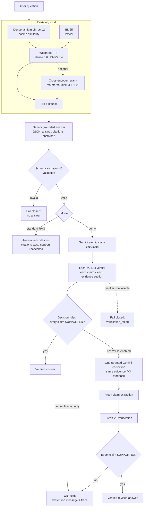

# RAGForge architecture

This document describes the final (v1.0) pipeline and the code that implements each stage. For measured results see [EVALUATION.md](EVALUATION.md); for the full development history see [DEVELOPMENT_LOG.md](DEVELOPMENT_LOG.md).

## Pipeline

Only answer generation, claim extraction and correction call Gemini. Retrieval, reranking and verification run locally.

## Three operating modes

| Mode | Command | What is checked | Gemini calls |
|---|---|---|---|
| **1. Standard RAG** | `python -m src.rag --question "..."` | JSON schema; every citation names a supplied section. **Not** whether the cited text supports the answer. | 1 |
| **2. RAG + local verification** | `... --verify` | Each atomic claim is checked by V3 against every evidence section. The answer is shown only if every claim is SUPPORTED; otherwise it is withheld. | 2 (answer, extraction) |
| **3. RAG + verification + correction** | `... --verify --revise` | As mode 2, plus one targeted Gemini correction of a failed answer, followed by fresh extraction and fresh V3 verification on the same evidence. | 2–4 |

`--verify --verifier gemini` keeps the original M5 Gemini verifier as an experimental alternative; `--verifier mock` is an offline lexical heuristic for testing only.

## Components

| Stage | Module | Key functions / classes |
|---|---|---|
| Documents and chunking | [src/ingest.py](../src/ingest.py), [src/chunking.py](../src/chunking.py) | `load_documents`, `chunk_documents` (section-aware, ≤ 120 words, `chunk_id = <section_id>#<n>`) |
| Dense retrieval | [src/embeddings.py](../src/embeddings.py), [src/retrieve.py](../src/retrieve.py) | `sentence-transformers/all-MiniLM-L6-v2`, `build_search_index`, `search` |
| BM25 | [src/bm25.py](../src/bm25.py) | self-contained BM25 (no extra dependency) |
| Fusion | [src/fusion.py](../src/fusion.py), `retrieve.fuse_rankings` | weighted reciprocal rank fusion |
| Reranking (optional) | [src/rerank.py](../src/rerank.py) | `cross-encoder/ms-marco-MiniLM-L-6-v2`, methods `dense-rerank`, `hybrid-rerank` |
| Grounded generation | [src/rag.py](../src/rag.py), [src/prompts.py](../src/prompts.py), [src/llm.py](../src/llm.py) | `answer_question`, `build_prompt`, `GeminiClient` (timeouts, bounded retries) |
| Citation checks | [src/citations.py](../src/citations.py) | `parse_answer`, `validate_citations` (exact section-ID match, never repaired) |
| Claim extraction | [src/claims.py](../src/claims.py) | `GeminiClaimExtractor`, `parse_claims` (strict schema, number-drift checks) |
| Verifier contract | [src/verification.py](../src/verification.py) | `verify(claims, evidence) -> StageOutput`, `parse_verdicts`, `GeminiVerifier`, `MockVerifier` |
| Local NLI | [src/nli.py](../src/nli.py), [src/local_verifier.py](../src/local_verifier.py) | `LocalNLI`, `LocalNLIVerifier`, `load_v3`, `group_evidence`, `decide` |
| Verification and correction | [src/self_correction.py](../src/self_correction.py) | `verify_and_correct`, `answer_question_verified` (`revise=False` default) |
| NLI dataset and training | [src/nli_dataset.py](../src/nli_dataset.py), [src/nli_review.py](../src/nli_review.py), [src/nli_train.py](../src/nli_train.py) | dataset generation, review / freeze, V1–V3 experiments, one-time `--test` |

## Local V3 verification

- **Model:** `cross-encoder/nli-MiniLM2-L6-H768` (RoBERTa-style, 82.1 M parameters) fully fine-tuned on the RAGForge policy NLI dataset (M6.3, "V3"). Labels come from the checkpoint's `id2label`: contradiction → CONTRADICTED, entailment → SUPPORTED, neutral → INSUFFICIENT_EVIDENCE.
- **Input:** premise = raw evidence text (no titles), hypothesis = the claim, at most 512 tokens. Over-length pairs are never truncated and accepted; they are marked unresolved (`token_limit`). Current evidence is at most 130 tokens per pair.
- **Evidence grouping:** chunks of one section are joined in chunk order; different sections are never joined; nothing is retrieved during verification.
- **Loading:** once per process and device, local files only. Before use, every checkpoint file is checked against the SHA-256 recorded at the final M6.3 test, and the loaded parameters against the recorded parameter hash. Any failure raises `VerifierUnavailable`, and the answer is withheld (no fallback to Gemini).
- **Decision rules** (deterministic; argmax labels only; softmax scores are recorded as *uncalibrated* and never thresholded):

  | Situation | Verdict | Reason |
  |---|---|---|
  | No evidence | INSUFFICIENT_EVIDENCE | `missing_evidence` |
  | One section entails, another contradicts | CONTRADICTED | `conflicting_evidence` |
  | A section contradicts | CONTRADICTED | `contradiction` |
  | A section was too long to evaluate | INSUFFICIENT_EVIDENCE | `token_limit` |
  | A complete section entails a possibly compound claim | INSUFFICIENT_EVIDENCE | `possible_compound` |
  | A complete section entails | SUPPORTED | `entailment` |
  | Only a known-incomplete section entails | INSUFFICIENT_EVIDENCE | `incomplete_section` |
  | Otherwise | INSUFFICIENT_EVIDENCE | `no_entailment` |

  The rules prefer withholding: one contradicting section outweighs a supporting one. This keeps false acceptance low but makes the pipeline sensitive to false contradictions (see [EVALUATION.md](EVALUATION.md)).

## Targeted correction (opt-in)

With `--revise`, an answer with any non-SUPPORTED claim gets exactly one correction request. The prompt ([`build_targeted_revision_prompt`](../src/prompts.py)) contains the original evidence, question and answer, and for every claim its verdict, decision reason, supporting / contradicting / unresolved section IDs and V3's label for each section. Conflicting claims get an explicit block naming both sides, and Gemini is asked to decide whether the sections really disagree or describe different events (for example refund *eligibility* versus refund *processing*). The checks are presented as fallible; the evidence text decides.

The corrected answer must pass the JSON and citation checks, then its claims are extracted again and **every** claim is verified again by V3 on the same evidence snapshot. Earlier verdicts are never reused. There is no second correction and no new retrieval.

Infrastructure failures (verifier unavailable, integrity failure, invalid verifier output, extraction failure, API errors) never trigger a correction; they end the run with the answer withheld.

## Fail-closed outcomes

Every verified run ends in one recorded outcome (`verification.outcome`):

| Outcome | Shown to the user |
|---|---|
| `accepted_original`, `accepted_revision` | the verified answer and citations |
| `unverified` (verification only), `revision_unsupported` | a standard abstention message; the rejected text stays in the trace |
| `abstained` | the model's abstention |
| `extraction_failure`, `verification_api_failure`, `invalid_verifier_output`, `citation_failure`, `revision_api_failure`, `revision_invalid_output`, `generation_failure` | no answer (`verification_failed`) |

The evidence snapshot is read-only and fingerprinted (`chunk_id`, `section_id`, `text`); the fingerprint is re-checked at the end of every run. `--json` prints the full trace: both passes, all claims, per-section NLI labels, logits and uncalibrated scores, the correction prompt type, feedback and raw response, latency and token usage.
